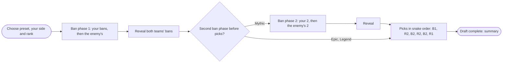
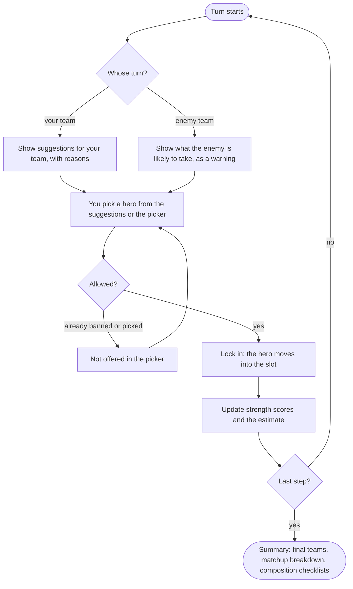
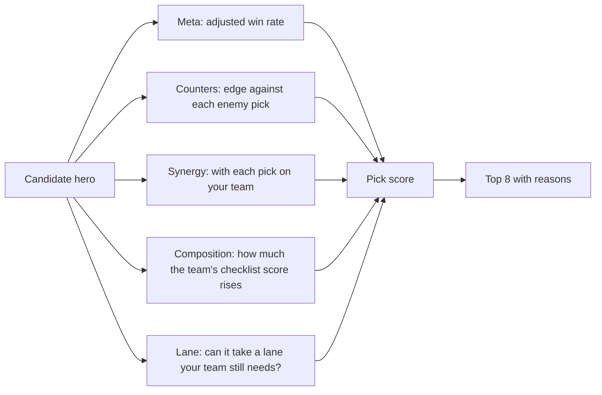
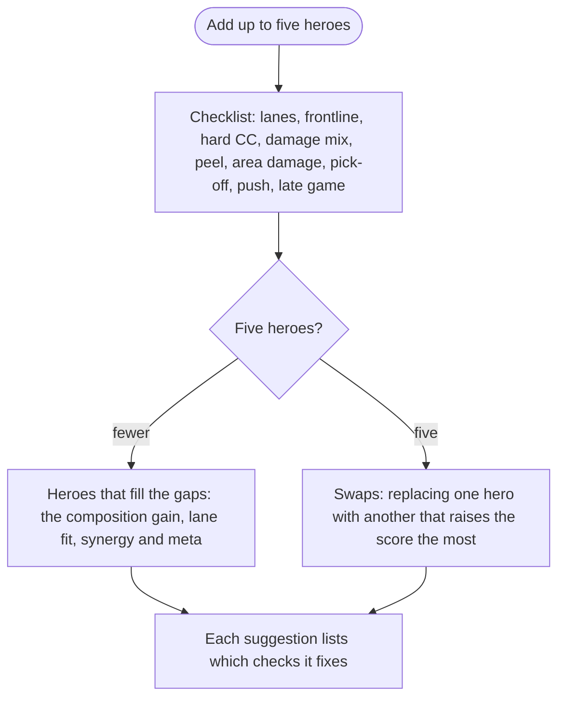

# Activity: Draft master and Team composition

Status: draft for review. Nothing in Phase 5 is built until the ban and pick
order below is confirmed. Once it is, this document describes what the code
in `src/config/draft-order.ts`, `src/config/draft-scoring.ts`,
`src/lib/scoring/draft.ts` and the two pages does. Update it in the same commit
as any change to the flow.

## In short

|            | Draft master (`/draft`)                                            | Team composition (`/team-composition`)                         |
| ---------- | ------------------------------------------------------------------ | -------------------------------------------------------------- |
| Job        | Practice a ranked ban and pick, with suggestions on every turn      | Check one team of up to five heroes and fix what it lacks       |
| Input      | Both teams' bans and picks, entered turn by turn                    | Up to five heroes                                               |
| Output     | Suggested heroes for the current turn, a strength score per team, the matchup estimate once both teams have picks | The checklist, what is missing, heroes that fill the gaps, swaps for a full team |
| Data       | The 7-day snapshot of the chosen rank (same files as Counter pick)   | Same                                                            |
| State      | In the URL, so a draft can be shared or reopened                    | In the URL                                                      |

Both pages reuse what Phase 4 built: the hero picker, the edge between two
heroes (`src/config/counter-scoring.ts`), synergy, the composition checklist
(`src/config/composition-rules.ts`) and the matchup estimate
(`src/config/matchup-scoring.ts`). Nothing new is stored in the database.

## Ban and pick order (please confirm)

Sources disagree on some details and Moonton publishes no official rules
page, so the order lives in one config file, `src/config/draft-order.ts`, as
presets. What the sources agree on:

- Draft pick starts at Epic. Each team bans **3 heroes at Epic, 4 at Legend
  and 5 at Mythic and above**. A party with a Mythic player uses the Mythic
  rules.
- In ranked, both teams ban **at the same time and blind**: you only see the
  other team's bans when the phase ends. At Mythic the bans come in **two
  waves, 3 and then 2**, and both waves happen before the first pick.
- Picks follow a **snake order**: Blue 1, Red 2, Blue 2, Red 2, Blue 2, Red 1.
- Tournaments (MPL) use a different order, with the second ban phase in the
  middle of the picks.

Proposed presets (the default is **Ranked: Mythic and above**):

| Preset | Ban phase 1 | Picks | Ban phase 2 | Picks |
| --- | --- | --- | --- | --- |
| Ranked: Epic | 3 each, blind | B1, R2, B2, R2, B2, R1 | none | none |
| Ranked: Legend | 4 each, blind | B1, R2, B2, R2, B2, R1 | none | none |
| Ranked: Mythic and above | 3 each, blind | after ban phase 2 | 2 each, blind | B1, R2, B2, R2, B2, R1 |
| Tournament (MPL) | B, R, B, R, B, R (3 each, in turn) | B1, R2, B2, R1 | R, B, R, B (2 each, in turn) | R1, B2, R1 |

Blind bans need care in a practice tool: one person enters both teams. The
board asks for your team's bans first, then the enemy team's, and shows them
together when the phase ends, as the game does. In the game two teams can ban
the same hero; the board allows that too, so a blind phase can end with fewer
than six distinct bans.



## A turn on the board

The draft is a list of steps from the preset, for example
`{ team: blue, action: ban }` or `{ team: red, action: pick }`. The board
always shows whose turn it is. Every hero placed is one entry in a list kept
in the URL (`/draft?preset=mythic&side=blue&rank=mythic&d=fanny,ling,…`), so
undo removes the last entry, and a refresh or a shared link rebuilds the same
board.



- **Undo** takes back the last hero. **Reset** clears the board and keeps the
  preset and side. **Swap sides** switches you between blue and red; the
  order stays tied to the colors, as in the game.
- **Rank** only changes the numbers the suggestions use. It does not change
  the preset; you can practice a Mythic draft with Epic statistics.
- The lock-in is the page's one animation: the portrait settles into its slot
  with a short scale and fade (GSAP, loaded on this page only). With reduced
  motion it appears at once.
- No timer for now. The game gives about 30 seconds per pick; a timer can come
  later if it helps practice.

## Suggestions

All suggestions use the same points as Counter pick and Matchup, where one
point is about one percentage point of win rate, and each one lists its
reasons. Heroes that are banned or picked never appear. The weights go in
`src/config/draft-scoring.ts`.



**Pick suggestions** (your pick turn):

- Meta: (adjusted win rate − 50%) × 100 × 0.3, as in Counter pick.
- Counters: the sum of the hero's edges against every enemy pick so far.
- Synergy: the sum of the win rate change with each teammate already picked,
  plus 1 point for each official "best teammate" note between them.
- Composition: how many points the team's checklist score rises with this
  hero, times 10 (the same scale as Matchup).
- Lane: heroes that cannot take any lane your team still has open drop out of
  the list unless you switch the filter to "Any lane". Lanes come from the
  official hero data.

**Ban suggestions** (your ban turn):

- Before any pick, a ban is about strength alone: the tier score (which
  already counts ban rate) of every hero, strongest first.
- In the second ban phase of the Tournament preset, picks exist, so the ban
  score adds how well the hero would counter your picks and how well it fits
  the enemy's picks: the same pick score, seen from the enemy's side.

**Enemy turns** show the enemy's top suggestions under "Watch out for". It is
the same calculation from the other side. It does not predict what a real
player will do; it shows what would hurt you most.

## Draft strength

Each team gets a strength score from 0 to 100 that does not depend on the
other team, plus the head-to-head estimate once both teams have picks:

- **Strength** = 40 × composition score + 30 × form + 30 × synergy, where:
  - composition score is the checklist score from `composition-rules.ts`
    (0 to 1), counted on the heroes picked so far;
  - form is the average percentile of the picked heroes' adjusted win rate
    among all heroes in the rank (0 to 1);
  - synergy is 0.5 plus the team's synergy points ÷ 20, kept between 0 and 1.
- **Estimate** is the Matchup estimate (blue against red, 30% to 70%) from
  form, counters, synergy and, once both teams are full, composition.

Strength answers "is my team sound"; the estimate answers "who is ahead".
Both are labelled as rule-based.

## Team composition page



- Every check shows its number and what it needs ("Frontline 2, needs 3"),
  with a short plain sentence for missing checks ("No one can take hits at
  the front").
- Suggestions rank heroes by how much they raise the composition score, then
  by lane fit, synergy with the team and meta.
- For a full team, the page lists up to three swaps that raise the score the
  most, for example "Swap Layla for Claude: Peel and Late game turn OK".
- The page shows the same strength score as Draft master, so the two tools
  agree.

## Screens

```
Mobile, Draft master                      Desktop, Draft master
┌──────────────────────────────┐          ┌───────────────────────────────────────────────┐
│ Mythic preset, you are Blue ⟲│          │ Preset, side, rank, undo, reset, swap         │
├──────────────────────────────┤          ├──────────────┬────────────────────────────────┤
│ Red  bans ▢▢▢▢▢   strength 61│          │ Suggestions  │            Red team  ▢▢▢▢▢    │
│      picks ▢▢▢▢▢             │          │ (your turn)  │         bans ▢▢▢▢▢ strength 61 │
├──────────────────────────────┤          │ 1 Khufra +6.2│        ╱                       │
│ Your turn: pick 2 of 2       │          │ 2 …          │      ╱  turn banner, estimate  │
├──────────────────────────────┤          │              │    ╱                           │
│ Blue picks ▢▢▢▢▢  strength 58│          │ Search heroes│ Blue team ▢▢▢▢▢               │
│      bans ▢▢▢▢▢              │          │ (picker)     │ bans ▢▢▢▢▢  strength 58        │
├──────────────────────────────┤          └──────────────┴────────────────────────────────┘
│ Suggested for you            │
│ 1 Khufra  +6.2  Why ▾        │          Blue sits bottom left and red top right, as on the
│ 2 …                          │          map. On phones the picker opens as a bottom sheet.
│ [ Search all heroes ]        │
└──────────────────────────────┘
```

## Testing

- The presets: each has the right number of bans and picks per team, and every
  step has a team and an action.
- Board logic: placing, undo, reset, swapping sides, rejecting a hero that is
  banned or picked, rebuilding from the URL, ignoring a broken URL.
- Suggestions and strength: small hand-computed cases, as in Phase 4, plus a
  sanity case: against an enemy Fanny, hard crowd control heroes rise.
- Screenshots of both pages on mobile and desktop in light and dark, and a
  click-through of a full Mythic draft in a browser.
