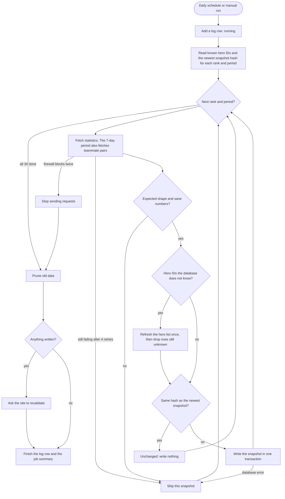
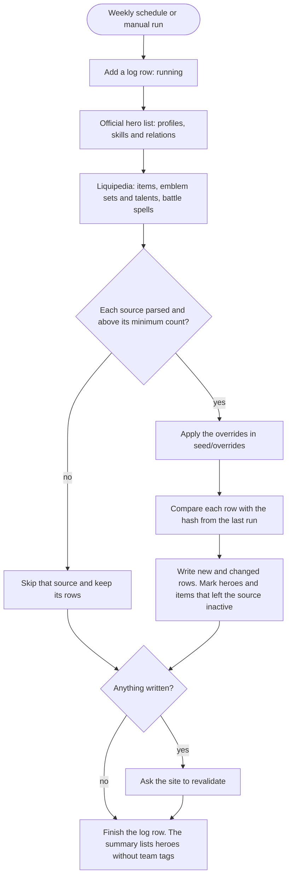

# Activity: data updater

Status: confirmed on 15 Oct 2026 (per-row hashes for manual corrections,
morning schedule in WIB). The code in `scripts/updater/` and the two
workflows follow this document. Update it in the same commit as any change to
the flow.

## In short

|                    | Stats job                                                   | Catalog job                                                                  |
| ------------------ | ----------------------------------------------------------- | ---------------------------------------------------------------------------- |
| Schedule           | Daily, 03:17 UTC (10:17 WIB)                                | Mondays, 03:47 UTC (10:47 WIB)                                               |
| Source             | Official ranked statistics (`api.gms.moontontech.com`)      | Official hero list, plus Liquipedia for items, emblems, talents and spells  |
| Requests           | About 36, one at a time, 2 to 2.6 s apart (about 2 minutes) | About 10: 1 official, about 8 to Liquipedia 2.5 to 3 s apart                 |
| Writes             | A new snapshot for each rank and period whose numbers changed | Catalog rows whose source data changed since the last run                  |
| Workflow           | `.github/workflows/update-stats.yml`                        | `.github/workflows/update-catalog.yml`                                       |

- Both jobs also run on demand from the Actions tab, with a dry run option
  that fetches and checks everything but writes nothing.
- They share one concurrency group, so they never run at the same time.
- Vercel never runs the updater. The site only reads the database when a
  page is rendered at build time or revalidated.
- GitHub only runs scheduled and dispatched workflows from the default
  branch, so the schedule starts once the Phase 3 work is merged into
  `main`. Until then, test runs are started from the working branch by
  pushing a request file, the same way as the seed fetch.

## Stats job

**What a snapshot is.** One rank (All, Epic, Legend, Mythic, Mythic Honor,
Mythic Glory) times one period (1, 3, 7, 15 or 30 days) is 30 snapshots per
run. Each holds every hero's win, pick and ban rate. The 7-day snapshots also
hold matchup and teammate pairs. `snapshot_date` is the UTC date of the run.

**Unchanged data.** The source refreshes its numbers about every 6 hours. The
job hashes each snapshot and compares it with the newest one for the same
rank and period, hidden or not, so a snapshot you hid is not written again
with the same numbers. Same hash, nothing is written.

**Writing.** A SQL function writes each snapshot in one database transaction:

1. Delete an earlier snapshot for the same rank, period and date, so a second
   run on the same day replaces it.
2. Insert the snapshot as published, with its hero stats, matchups and
   teammate pairs.

If any step fails, the whole transaction rolls back and the previous snapshot
stays. The site therefore reads either the old snapshot or the complete new
one, never half of it. `is_published` remains a manual switch: setting it to
false in the Table Editor hides a bad snapshot, and the site falls back to
the one before it.

**New heroes.** If the statistics mention a hero the database does not know,
the job refreshes the official hero list first (1 extra request). A new hero
then gets stats on the day it appears instead of waiting for Monday.

**Pruning** (a SQL function, after the snapshots):

- Matchup and teammate pairs are kept for the newest snapshot that has them,
  per rank. Older pairs are deleted.
- Snapshots older than 120 days are deleted with their rows. The Statistics
  page uses this history for "change since the previous period".
- Log rows older than one year are deleted.

That keeps about 480,000 hero stat rows (about 60 MB with indexes), well
inside the 500 MB of the free plan.

**Run status**

| Status  | When                                                              | Workflow result                           |
| ------- | ----------------------------------------------------------------- | ----------------------------------------- |
| success | Every snapshot was written or unchanged                           | Green                                     |
| skipped | Every snapshot was unchanged                                      | Green                                     |
| partial | Some snapshots were skipped because of errors, the rest are fine  | Green, with warnings in the job summary. Red when the firewall stopped the run |
| failed  | Nothing could be written: the firewall blocked the run, every read failed, or a crash | Red. GitHub emails you about failed runs |

## Catalog job

- **Heroes.** One official record per hero holds the profile, skills and
  relations. A changed hero gets its row updated and its skills and relations
  replaced. A hero missing from the source is marked inactive, never deleted,
  because its statistics history still points to it. Fewer than 100 heroes
  means the source broke, and the job leaves the heroes alone.
- **Items.** Same rules, with a minimum of 80 items.
- **Emblems, talents and battle spells.** These tables have no inactive flag.
  A row that leaves the source is deleted, but only when the whole source
  parsed (all 7 emblem sets, every spell listed in the wiki's navigation box).
- **Team tags.** The updater never changes `hero_tags`. Tags in
  `seed/hero-tags.json` for a hero that has no tag row yet are inserted, so a
  new hero gets tags once someone adds them to that file. Existing rows are
  never touched, so edits in the Table Editor stay.
- **Liquipedia terms.** At least 2 seconds between requests (we use 2.5 s
  plus jitter), a User-Agent with the project URL, gzip, and the CC BY-SA 3.0
  credit the site already shows.

## Keeping corrections made in the Table Editor

Without a rule, the weekly catalog run would overwrite a fix made by hand.
Proposal:

- The job stores a hash of each catalog row's source data in a new table,
  `source_hashes`. A row is written only when its source data changed since
  the last run. A fix made in the Table Editor stays until the source itself
  changes that row, for example when a patch changes that hero.
- A fix that must survive source changes goes into `seed/overrides/`, which
  every run applies after fetching. Items already have one.
- Statistics are never edited by hand. To hide a bad snapshot, set its
  `is_published` to false.

## Requests, retries and the firewall

| Situation                                                               | What the updater does                                                                          | What the site shows                     |
| ----------------------------------------------------------------------- | ---------------------------------------------------------------------------------------------- | --------------------------------------- |
| Normal                                                                  | One request at a time, 2 s plus up to 0.6 s apart, with a fixed User-Agent naming the project | New data after the run                  |
| Network error, 30 s timeout, or a 408, 429 or 5xx answer in JSON       | Retry up to 4 times, after 2, 4, 8 and 16 s plus jitter. Then skip that snapshot or source    | The previous data                       |
| Firewall page (405 or 429 answered with HTML)                           | Wait 60 s once. Blocked again: stop every request for this run                                 | The previous data                       |
| Response shape changed                                                  | Skip that snapshot or source. The summary names the field that failed                          | The previous data                       |
| Numbers fail the checks: under 80% of heroes, pick rates far from summing to 1, mean win rate outside 45 to 55% | Skip that snapshot                                                   | The previous data                       |
| Database error                                                          | The transaction rolls back. Skip that snapshot                                                 | The previous data                       |
| Revalidation fails, or the site is not deployed yet                     | Warning only                                                                                   | New data at the next 6-hour refresh     |
| Crash                                                                   | The log row is closed as failed. A row still marked running after 2 hours is closed by the next run | The previous data                  |

Responses are cached for 20 hours in the Actions cache, so a manual rerun on
the same day sends no new requests. The manual run has a "fresh" option that
ignores the cache.

## Logs and the job summary

Each run writes one `data_update_logs` row: job, status, how it was started,
start and end time, requests, retries, rows written, a short message,
per-snapshot details (written, unchanged or skipped, and why) and the link to
the workflow run. The same table appears in the job summary on the Actions
page. The log table is publicly readable like every other table, so it never
holds secrets, keys or private URLs.

## Telling the site to refresh

After a run that wrote something, the updater sends
`POST {SITE_URL}/api/revalidate` with `Authorization: Bearer
<REVALIDATE_SECRET>`. The route accepts only POST, compares the secret in
constant time and expires the `game-data` cache tag with
`revalidateTag("game-data", "max")`. The next visit to a page gets the cached
page while a fresh one renders in the background; later visits get the fresh
one. While `SITE_URL` is not set (before Vercel is set up), this step is
skipped with a notice.

If the newest statistics are more than 48 hours old, the Statistics and Tier
list pages say so next to the update date.

## Keeping the schedule alive

GitHub disables scheduled workflows in a public repository after 60 days
without repository activity. Each stats run calls GitHub's "enable workflow"
API for both workflows with the run's own token, which keeps them on without
dummy commits.

## Database changes (one migration)

- `write_stat_snapshot(payload jsonb)`: the transaction described above.
- `prune_stats(keep_days integer default 120)`: the pruning described above.
- `source_hashes (kind, source_id, hash, seen_at)`: the per-row hashes for the
  catalog job, with RLS on and public read like every other table.

Only the service role may run the two functions. The migration is tested on
local Postgres first, then applied to Supabase through MCP, as in Phase 1.

## Secrets and settings

| Name                        | Where                                  | Used for                                              |
| --------------------------- | -------------------------------------- | ----------------------------------------------------- |
| `SUPABASE_URL`              | GitHub Secrets                         | Both jobs                                             |
| `SUPABASE_SERVICE_ROLE_KEY` | GitHub Secrets only (the `sb_secret_…` key) | Writing. Never in Vercel, the code or a commit   |
| `REVALIDATE_SECRET`         | GitHub Secrets and Vercel env          | Revalidation, once the site is on Vercel              |
| `SITE_URL`                  | GitHub Actions variable                | Revalidation                                          |

Without `SUPABASE_SERVICE_ROLE_KEY`, the workflows run as a dry run.

## Testing before the first real run

1. Unit tests: parsing, hashing, run status, and retry and firewall handling
   with a fake network.
2. The SQL functions on local Postgres 16 with the Supabase roles simulated:
   the public role cannot run them, and a failed write leaves the previous
   snapshot in place.
3. A dry run in the development container against recorded responses, since
   the container cannot reach the sources.
4. A dry run on GitHub Actions against the real sources, with no writes.
5. A real run once the secrets are in place, checked through MCP: the log row
   says success, row counts match, and the newest snapshot has today's date.

## Not part of the updater

- Hero builds: no official source since the MLBB Academy closed.
- Backfilling past days from the official daily trend data. Until the history
  builds up, "change since the previous period" on the Statistics page shows
  that there is not enough history yet.
