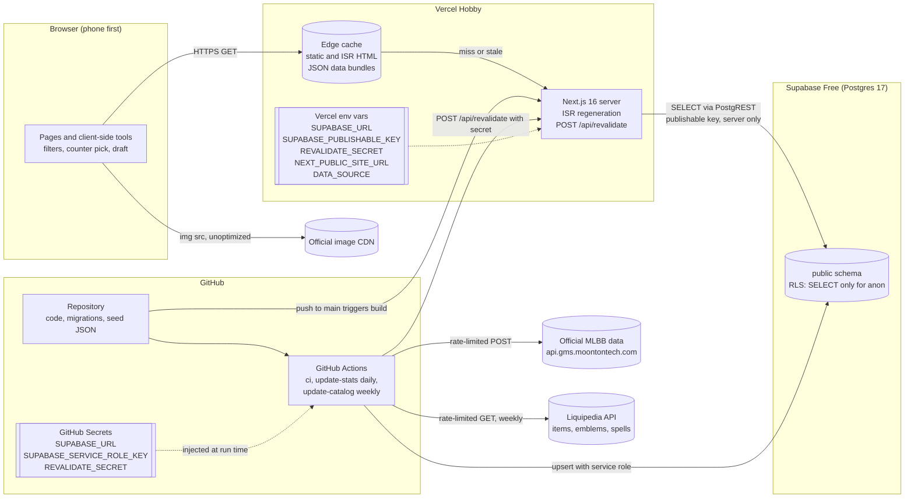
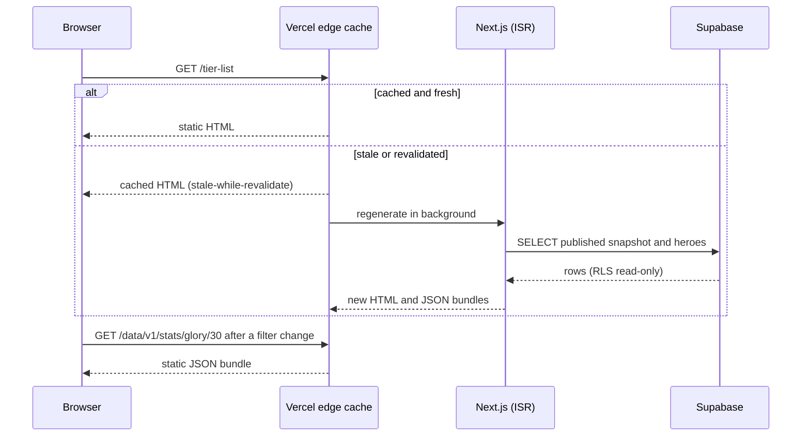
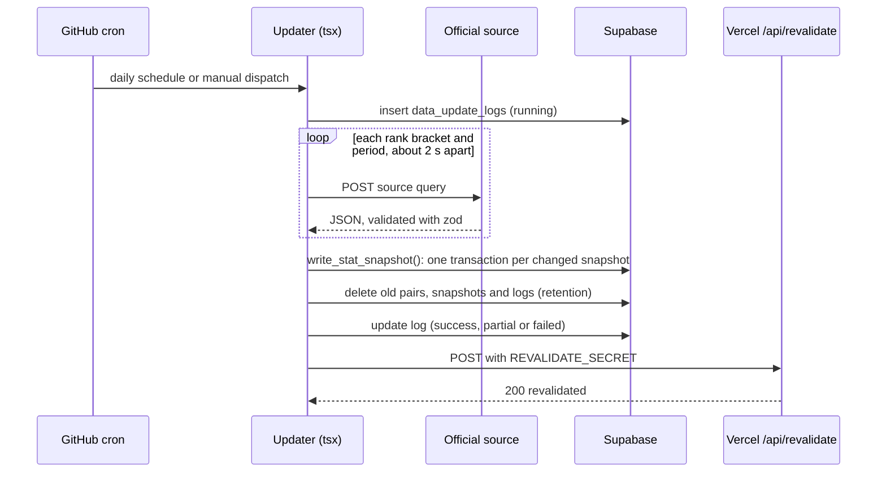

# Architecture: Metapick MLBB

Status: draft for review. Update this file whenever hosting, data flow, or secrets change.

## Constraints

- Free tier only: Vercel Hobby, Supabase Free, GitHub Actions.
- Pages are static or ISR. A visitor never triggers a database query directly; a page regenerates at most every few hours, or right after a data update.
- No Next.js image optimization: hero images load from the official CDN URL with `unoptimized`. Items, emblems and spells have no image source yet and render as styled monograms.
- The data updater runs in GitHub Actions, never on Vercel.
- The browser never talks to Supabase. This changes only when Supabase Auth is added later.

## Data sources

| Data | Source | License and terms | Refresh |
|---|---|---|---|
| Heroes, skills, official relations | Official website API (`api.gms.moontontech.com`, the low-code backend of mobilelegends.com) | Moonton content, shown with attribution and the "Not affiliated" disclaimer | Weekly (catalog job) |
| Win, pick and ban rates; counters and synergies | Same API; it serves CDN files the site config refreshes every 360 minutes | Same | Daily (stats job) |
| Items, emblems, talents, battle spells | [Liquipedia Mobile Legends wiki](https://liquipedia.net/mobilelegends) through its MediaWiki API | CC BY-SA 3.0: credited on the pages that show it; API terms: at most one request every 2 seconds, a User-Agent with contact details | Weekly (catalog job) |
| Composition tags | `seed/hero-tags.json`, curated by hand | Ours | On edit |
| Recommended builds | None: the official MLBB Academy that published them closed on 2026-06-30 | | Not shown |

Both scrapers run sequentially with pauses, retries with backoff, and a disk cache, and stop on a firewall block rather than retry harder.

## System overview

## Page request

### Static JSON bundles

Each page carries the data for its default rank (Mythic). Another choice loads a JSON file that is built with the site and refreshed with it, so filters never query the database:

| Path | Contents | Used by |
|---|---|---|
| `/data/v1/stats/{rank}/{period}` | Rates, tiers and changes for one rank and period (30 files) | Statistics, Tier list |
| `/data/v1/matchups/{rank}` | 7-day rates, matchups and synergies for one rank (6 files) | Counter pick, Matchup, Team composition, Draft master |
| `/data/v1/hero-notes` | The official explanation behind each hero note | Matchup |

The four tools score in the browser, with the pure functions in `src/lib/scoring/` and the weights in `src/config/counter-scoring.ts`, `matchup-scoring.ts`, `composition-rules.ts` and `draft-scoring.ts`. Draft master's ban and pick orders are presets in `src/config/draft-order.ts` (see `docs/activity-draft-master.md`).

## Data update

The weekly catalog job follows the same pattern for heroes (official API) and for the item, emblem and spell catalog (Liquipedia), writing only rows whose source data changed. Schedules, retries, firewall handling and failure behavior are in `docs/activity-updater.md`. The code is in `scripts/updater/`, the workflows are `.github/workflows/update-stats.yml` and `update-catalog.yml`.

## Seed data

The first data load does not run the updater. Two one-off imports write JSON into the repository, and `pnpm seed:sql` turns it into `supabase/seed.sql`:

- `pnpm seed:fetch` writes the official snapshot to `seed/official/` (heroes, skills, relations, ranked statistics).
- `pnpm seed:catalog` writes the Liquipedia catalog to `seed/liquipedia/` (items, emblems, talents, battle spells), with its license in `seed/liquipedia/meta.json`.

The development container cannot reach either source, so both run in GitHub Actions (`.github/workflows/seed-fetch.yml`), triggered by a change to `seed/fetch-request.json` on a working branch, and commit their output back to that branch.

## Secrets and configuration

| Name | Stored in | Used by | Notes |
|---|---|---|---|
| `SUPABASE_URL` | Vercel env, GitHub Secrets, `.env.local` | Next.js server, updater | Not secret, kept server-side |
| `SUPABASE_PUBLISHABLE_KEY` | Vercel env, `.env.local` | Next.js server (ISR reads) | Safe to expose; RLS limits it to SELECT. Kept server-side anyway |
| `SUPABASE_SERVICE_ROLE_KEY` | GitHub Secrets only (optionally `.env.local` for local updater runs) | Updater | Bypasses RLS. Never in Vercel, never in frontend code, never committed |
| `REVALIDATE_SECRET` | Vercel env, GitHub Secrets | `/api/revalidate`, updater | Long random string |
| `NEXT_PUBLIC_SITE_URL` | Vercel env | Metadata, sitemap, Open Graph | `https://metapick-mlbb.vercel.app` for now |
| `DATA_SOURCE` | Vercel env, `.env.local`, CI | Data layer | `supabase` in production, `seed` for local and CI builds |
| `SITE_URL` | GitHub Actions variable | Updater revalidate call | |
| `GITHUB_TOKEN` | Provided by Actions | Keepalive step | Scoped to the run |

`.env.local` is git-ignored. `.env.example` lists every variable with placeholder values.

## Free tier budget

| Resource | Limit | Expected use |
|---|---|---|
| Vercel image optimization | ~1,000 source images per month | 0 (`unoptimized`) |
| Vercel functions | Hobby limits | ISR regenerations of visited pages plus about one revalidate call per day |
| Supabase database | 500 MB | Under 100 MB with 120-day retention |
| Supabase egress | 5 GB per month | Small: server-side ISR reads only |
| Supabase inactivity pause | 7 days | Daily updater writes keep the project active |
| GitHub Actions | Free for public repositories | About 3 minutes per day plus about 15 minutes per week |
| Scheduled workflows | Disabled after 60 days without repository activity | Keepalive step re-enables them through the API |

## Environments

| Environment | Data source | Notes |
|---|---|---|
| Local / cloud session | `seed` (or `supabase` with `.env.local`) | No secrets needed to build |
| CI (`ci.yml`) | `seed` | Lint, typecheck, test, build |
| Production (Vercel, branch `main`) | `supabase` | ISR + on-demand revalidation |
