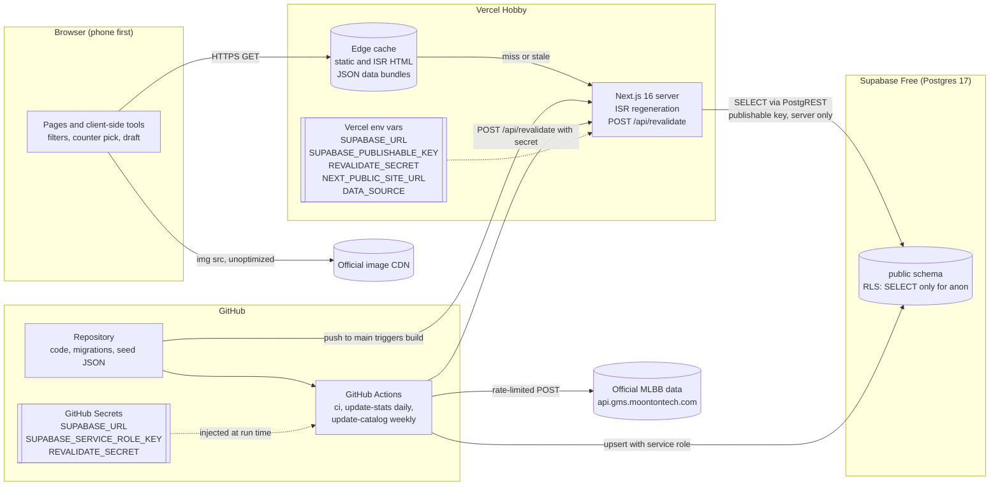
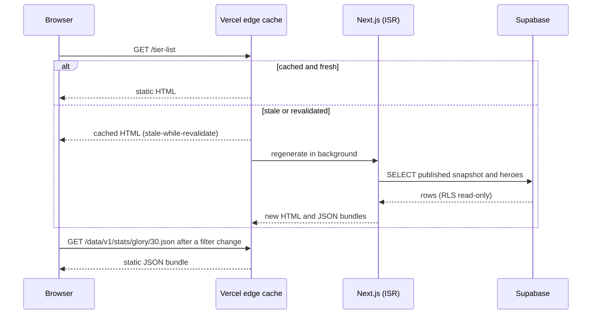
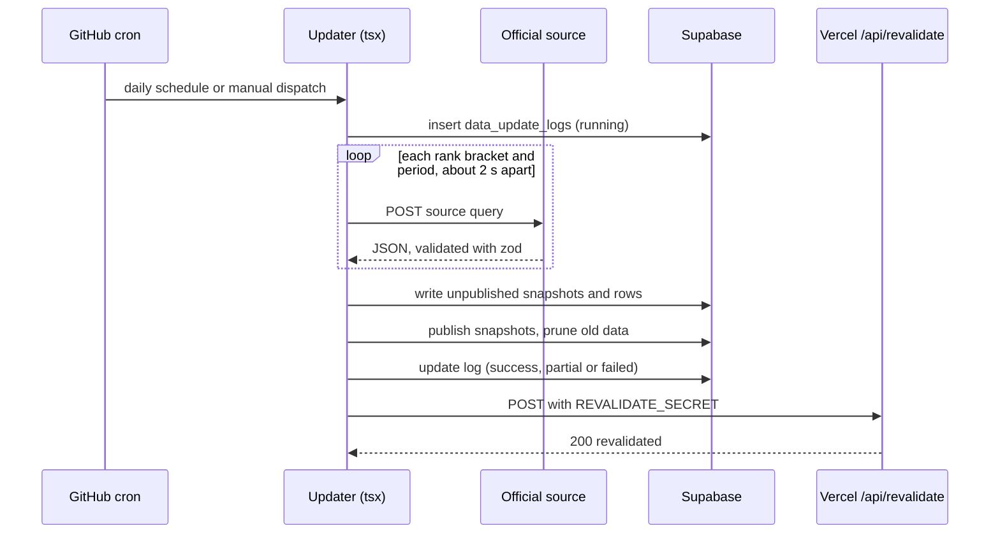

# Architecture: Metapick MLBB

Status: draft for review. Update this file whenever hosting, data flow, or secrets change.

## Constraints

- Free tier only: Vercel Hobby, Supabase Free, GitHub Actions.
- Pages are static or ISR. A visitor never triggers a database query directly; a page regenerates at most every few hours, or right after a data update.
- No Next.js image optimization: hero, item, and emblem images load from the source URL with `unoptimized`.
- The data updater runs in GitHub Actions, never on Vercel.
- The browser never talks to Supabase. This changes only when Supabase Auth is added later.

## System overview

## Page request

## Data update

Retries, WAF handling, and failure behavior are described in `docs/activity-updater.md` (written before Phase 3).

## Secrets and configuration

| Name | Stored in | Used by | Notes |
|---|---|---|---|
| `SUPABASE_URL` | Vercel env, GitHub Secrets, `.env.local` | Next.js server, updater | Not secret, kept server-side |
| `SUPABASE_PUBLISHABLE_KEY` | Vercel env, `.env.local` | Next.js server (ISR reads) | Safe to expose; RLS limits it to SELECT. Kept server-side anyway |
| `SUPABASE_SERVICE_ROLE_KEY` | GitHub Secrets only (optionally `.env.local` for local updater runs) | Updater | Bypasses RLS. Never in Vercel, never in frontend code, never committed |
| `REVALIDATE_SECRET` | Vercel env, GitHub Secrets | `/api/revalidate`, updater | Long random string |
| `NEXT_PUBLIC_SITE_URL` | Vercel env | Metadata, sitemap, Open Graph | `https://metapick-mlbb.vercel.app` for now |
| `DATA_SOURCE` | Vercel env, `.env.local`, CI | Data layer | `supabase` in production, `seed` for local and CI builds |
| `SITE_URL` | GitHub Actions variable | Updater revalidate call | |
| `GITHUB_TOKEN` | Provided by Actions | Keepalive step | Scoped to the run |

`.env.local` is git-ignored. `.env.example` lists every variable with placeholder values.

## Free tier budget

| Resource | Limit | Expected use |
|---|---|---|
| Vercel image optimization | ~1,000 source images per month | 0 (`unoptimized`) |
| Vercel functions | Hobby limits | ISR regenerations of visited pages plus about one revalidate call per day |
| Supabase database | 500 MB | Under 100 MB with 120-day retention |
| Supabase egress | 5 GB per month | Small: server-side ISR reads only |
| Supabase inactivity pause | 7 days | Daily updater writes keep the project active |
| GitHub Actions | Free for public repositories | About 3 minutes per day plus about 15 minutes per week |
| Scheduled workflows | Disabled after 60 days without repository activity | Keepalive step re-enables them through the API |

## Environments

| Environment | Data source | Notes |
|---|---|---|
| Local / cloud session | `seed` (or `supabase` with `.env.local`) | No secrets needed to build |
| CI (`ci.yml`) | `seed` | Lint, typecheck, test, build |
| Production (Vercel, branch `main`) | `supabase` | ISR + on-demand revalidation |
