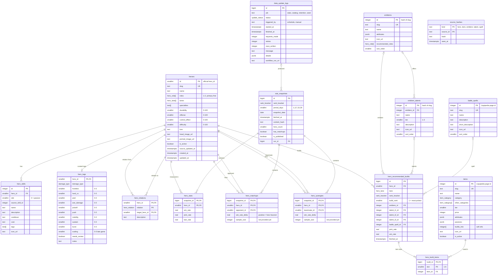

# Database ERD: Metapick MLBB

Source of truth: `supabase/migrations/`. Update this file in the same commit as any schema change.

- Engine: Supabase Postgres 17 (Free plan), schema `public`.
- Access: every table has Row Level Security enabled. The public (`anon`, `authenticated`) can only `SELECT`. Only the seed and updater scripts write, using the service role key from GitHub Secrets; the service role bypasses RLS.
- IDs: catalog tables use stable source IDs as primary keys, so upserts never need ID mapping. Heroes use the official `hero_id`. Items and battle spells use their Liquipedia page ID (stable across page moves). Emblem sets and talents have no pages of their own, so their ID is a stable hash of the slug.
- Sources: heroes, skills, relations and statistics come from the official website's API. Items, emblems, talents and battle spells come from the Liquipedia Mobile Legends wiki (CC BY-SA 3.0), because the official MLBB Academy closed on 2026-06-30. Recommended builds have no source since then: their tables exist but stay empty.
- Rates are stored as fractions (`0.5234` = 52.34%).

## Enums

| Enum | Values |
|---|---|
| `hero_role` | tank, fighter, assassin, mage, marksman, support |
| `hero_lane` | exp, mid, roam, jungle, gold |
| `rank_bracket` | all, epic, legend, mythic, honor, glory (official codes 101, 5, 6, 7, 8, 9) |
| `damage_type` | physical, magic, mixed |
| `item_category` | attack, magic, defense, movement, jungle, roam |
| `hero_relation` | best_teammate, strong_against, weak_against |
| `update_status` | running, success, partial, failed, skipped |

## Diagram



## Table structure

Common columns: catalog tables also have `created_at` and `updated_at` (`timestamptz not null default now()`), with `updated_at` kept by the `public.set_updated_at()` trigger (`security invoker`, `set search_path = ''`).

**heroes**: official hero catalog. Written by seed and the catalog job.

| Column | Type | Null | Default | Notes |
|---|---|---|---|---|
| id | smallint | no | | PK, official hero_id |
| slug | text | no | | Unique, URL slug (`yi-sun-shin`) |
| name | text | no | | |
| roles | hero_role[] | no | | 1–2 roles, primary first (check on cardinality) |
| lanes | hero_lane[] | no | `'{}'` | |
| specialties | text[] | no | `'{}'` | e.g. `{Charge,Crowd Control}` |
| durability, offense, control_effect, difficulty | smallint | yes | | Official 0–100 ratings |
| lore | text | yes | | |
| head_image_url, portrait_image_url | text | yes | | Source CDN URLs |
| is_active | boolean | no | true | false when the source no longer lists the hero |
| source_updated_at | timestamptz | yes | | Last change seen by the updater |

Indexes: PK (id); unique (slug); GIN (roles); GIN (lanes). RLS: public SELECT.

**hero_skills**

| Column | Type | Null | Default | Notes |
|---|---|---|---|---|
| id | integer identity | no | | PK |
| hero_id | smallint | no | | FK → heroes.id, on delete cascade |
| slot | smallint | no | | 0 = passive, then display order |
| source_skill_id | integer | yes | | Official skill id |
| name | text | no | | |
| description | text | no | | Sanitized plain text |
| cooldown, cost | text | yes | | As shown by the source |
| tags | text[] | no | `'{}'` | e.g. `{Burst,CC}` |
| icon_url | text | yes | | |

Indexes: PK (id); unique (hero_id, slot). RLS: public SELECT.

**hero_tags**: curated composition attributes, one row per hero. Source of truth: `seed/hero-tags.json`. Never written by the updater.

| Column | Type | Null | Default | Notes |
|---|---|---|---|---|
| hero_id | smallint | no | | PK, FK → heroes.id, on delete cascade |
| damage_type | damage_type | no | | |
| frontline, hard_cc, peel, aoe_damage, pickoff, push, mobility, sustain, burst, scaling | smallint | no | 0 | Check 0–3. 0 none, 1 some, 2 strong, 3 core strength. `scaling` = late-game scaling |
| needs_review | boolean | no | false | true when tags still need a human check |
| notes | text | yes | | |

Indexes: PK (hero_id). RLS: public SELECT.

**hero_relations**: official editorial relations from the hero detail page.

| Column | Type | Null | Default | Notes |
|---|---|---|---|---|
| hero_id | smallint | no | | PK part, FK → heroes.id, cascade |
| relation | hero_relation | no | | PK part |
| target_hero_id | smallint | no | | PK part, FK → heroes.id, cascade |
| description | text | yes | | Official explanation |

Indexes: PK (hero_id, relation, target_hero_id); (target_hero_id). RLS: public SELECT.

**items**: shop items from Liquipedia (CC BY-SA 3.0). Removed items are not imported.

| Column | Type | Null | Default | Notes |
|---|---|---|---|---|
| id | integer | no | | PK, Liquipedia page ID |
| slug | text | no | | Unique |
| name | text | no | | |
| category | item_category | no | | Main shop tab |
| other_categories | item_category[] | no | `'{}'` | Further shop tabs that list the item (for example Winter Crown: magic) |
| tier | smallint | yes | | 1 basic, 2 intermediate, 3 final; null for jungle and roam blessings |
| price | integer | yes | | Gold; `seed/overrides/items.json` corrects it when the wiki lags |
| attributes | jsonb | no | `'[]'` | `[{"label":"Physical Attack","value":"+60"}]`; unique attributes carry "(unique)" in the label |
| passives | jsonb | no | `'[]'` | `[{"name":"…","description":"…"}]` |
| builds_into | integer[] | no | `'{}'` | Soft reference to items.id (no FK) |
| icon_url | text | yes | | |
| is_active | boolean | no | true | |

Indexes: PK (id); unique (slug); (category); GIN (other_categories). RLS: public SELECT.

**emblems**: emblem sets from the Liquipedia emblem portal.

| Column | Type | Null | Default | Notes |
|---|---|---|---|---|
| id | integer | no | | PK, stable hash of the slug |
| slug | text | no | | Unique |
| name | text | no | | |
| attributes | jsonb | no | `'[]'` | Set bonuses |
| icon_url | text | yes | | |
| recommended_roles | hero_role[] | no | `'{}'` | The role the set is named after; empty for Basic Common |
| sort_order | smallint | no | 0 | |

Indexes: PK (id); unique (slug). RLS: public SELECT.

**emblem_talents**: each set offers its own talents plus those of Basic Common, which every set offers. A loadout picks one talent per tier.

| Column | Type | Null | Default | Notes |
|---|---|---|---|---|
| id | integer | no | | PK, stable hash of the slug |
| emblem_id | integer | yes | | FK → emblems.id, on delete set null: the set that offers it |
| name | text | no | | |
| tier | smallint | no | | Check 1–3: 1 attribute talent, 2 effect talent, 3 core talent |
| description | text | no | | |
| icon_url | text | yes | | |
| sort_order | smallint | no | 0 | |

Indexes: PK (id); (emblem_id); (tier). RLS: public SELECT.

**battle_spells**: the spells in Liquipedia's battle spell navbox, in its order. The description ends with the cooldown.

| Column | Type | Null | Default | Notes |
|---|---|---|---|---|
| id | integer | no | | PK, Liquipedia page ID |
| slug | text | no | | Unique |
| name, description | text | no | | |
| short_description, icon_url | text | yes | | |
| sort_order | smallint | no | 0 | |

Indexes: PK (id); unique (slug). RLS: public SELECT.

**stat_snapshots**: one row per rank bracket × period × date.

| Column | Type | Null | Default | Notes |
|---|---|---|---|---|
| id | bigint identity | no | | PK |
| rank_bracket | rank_bracket | no | | |
| period_days | smallint | no | | Check in (1, 3, 7, 15, 30) |
| snapshot_date | date | no | | UTC date of the fetch |
| fetched_at | timestamptz | no | now() | Shown as "Updated …" |
| content_hash | text | no | | Skip writes when unchanged |
| hero_count | smallint | no | | Sanity check |
| has_matchups | boolean | no | false | Matchups/synergies stored for this snapshot |
| is_published | boolean | no | false | Set to true after all child rows are written |
| run_id | bigint | yes | | FK → data_update_logs.id, on delete set null |
| created_at | timestamptz | no | now() | |

Indexes: PK (id); unique (rank_bracket, period_days, snapshot_date); (rank_bracket, period_days, snapshot_date desc) where is_published; (run_id). RLS: public SELECT where `is_published`.

**hero_stats**: win/pick/ban rate per hero in a snapshot. Tier is not stored; the app computes it from `src/config/tier-scoring.ts`.

| Column | Type | Null | Default | Notes |
|---|---|---|---|---|
| snapshot_id | bigint | no | | PK part, FK → stat_snapshots.id, cascade |
| hero_id | smallint | no | | PK part, FK → heroes.id, cascade |
| win_rate, pick_rate, ban_rate | real | no | | Check 0–1 |

Indexes: PK (snapshot_id, hero_id); (hero_id). RLS: public SELECT when the parent snapshot is published.

**hero_matchups**: hero vs opponent, normalized to the hero's perspective.

| Column | Type | Null | Default | Notes |
|---|---|---|---|---|
| snapshot_id | bigint | no | | PK part, FK → stat_snapshots.id, cascade |
| hero_id | smallint | no | | PK part, FK → heroes.id, cascade |
| opponent_id | smallint | no | | PK part, FK → heroes.id, cascade |
| win_rate_delta | real | no | | Change in the hero's win rate against this opponent (positive = hero favored) |
| sample_size | integer | yes | | The source does not provide match counts today |

Indexes: PK (snapshot_id, hero_id, opponent_id); (hero_id); (opponent_id). RLS: public SELECT when the parent snapshot is published.

**hero_synergies**: same shape as `hero_matchups`, with `teammate_id` instead of `opponent_id`; `win_rate_delta` is the change in the hero's win rate when playing with that teammate. Indexes: PK (snapshot_id, hero_id, teammate_id); (hero_id); (teammate_id). Same RLS.

**hero_recommended_builds**: empty for now. Its only source, the official MLBB Academy, closed on 2026-06-30, and hero pages do not show builds.

| Column | Type | Null | Default | Notes |
|---|---|---|---|---|
| id | bigint identity | no | | PK |
| hero_id | smallint | no | | FK → heroes.id, cascade |
| lane | hero_lane | no | | |
| rank_bracket | rank_bracket | no | | |
| build_rank | smallint | no | | 1 = most picked |
| emblem_id | integer | yes | | FK → emblems.id, on delete set null |
| talent_t1_id, talent_t2_id, talent_t3_id | integer | yes | | FK → emblem_talents.id, on delete set null |
| battle_spell_id | integer | yes | | FK → battle_spells.id, on delete set null |
| pick_rate, win_rate | real | yes | | Build popularity and result |
| fetched_at | timestamptz | no | now() | |

Indexes: PK (id); unique (hero_id, lane, rank_bracket, build_rank); one index per FK column (emblem_id, talent_t1_id, talent_t2_id, talent_t3_id, battle_spell_id). RLS: public SELECT.

**hero_build_items**

| Column | Type | Null | Default | Notes |
|---|---|---|---|---|
| build_id | bigint | no | | PK part, FK → hero_recommended_builds.id, cascade |
| slot | smallint | no | | PK part, check 1–6 |
| item_id | integer | no | | FK → items.id, on delete restrict |

Indexes: PK (build_id, slot); (item_id). RLS: public SELECT.

**data_update_logs**

| Column | Type | Null | Default | Notes |
|---|---|---|---|---|
| id | bigint identity | no | | PK |
| job | text | no | | Check in ('stats', 'catalog', 'retention', 'seed') |
| status | update_status | no | 'running' | |
| triggered_by | text | no | | Check in ('schedule', 'manual') |
| started_at | timestamptz | no | now() | |
| finished_at | timestamptz | yes | | |
| requests_made, retries, rows_written | integer | no | 0 | |
| message | text | yes | | Short summary; never contains secrets |
| details | jsonb | yes | | Per-step counts and timings |
| workflow_run_url | text | yes | | Link to the GitHub Actions run |

Indexes: PK (id); (job, started_at desc). RLS: public SELECT.

**source_hashes**: hash of each catalog row's source data at the last catalog run.

| Column | Type | Null | Default | Notes |
|---|---|---|---|---|
| kind | text | no | | PK part, check in ('hero', 'item', 'emblem', 'talent', 'spell') |
| source_id | text | no | | PK part, the row's ID as text |
| hash | text | no | | Hash of the row as the source gave it, overrides applied |
| seen_at | timestamptz | no | now() | |

Indexes: PK (kind, source_id). RLS: public SELECT.

## RLS policies

Every table has RLS enabled and one read policy:

```sql
alter table public.<table> enable row level security;
create policy "<table>: public read" on public.<table>
  for select to anon, authenticated using (true);
```

Exceptions:
- `stat_snapshots`: `using (is_published)`.
- `hero_stats`, `hero_matchups`, `hero_synergies`: `using (exists (select 1 from public.stat_snapshots s where s.id = snapshot_id and s.is_published))`.

There are no insert, update, or delete policies. As a second layer, the RLS migration revokes `insert, update, delete, truncate, references, trigger` on every table (and `usage, update` on sequences) from `anon` and `authenticated`, then grants `select` back. The service role used by the scripts bypasses RLS.

The checks live in `supabase/tests/rls_test.sql`. Run them against a disposable Postgres server with `TEST_DATABASE_URL=... scripts/db/test-migrations.sh`; CI runs the same script.

## Data lifecycle

- Seed (Phase 1): `seed/official/*.json` (official API) and `seed/liquipedia/*.json` (Liquipedia) plus `seed/hero-tags.json` → `supabase/seed.sql` (idempotent upserts), applied by the project owner.
- Stats job (daily, `docs/activity-updater.md`): each changed snapshot (bracket × period) is written by `public.write_stat_snapshot(payload jsonb)` in one transaction, replacing that day's snapshot if there is one, and published at once. `public.prune_stats(keep_days)` then deletes matchup and synergy rows of all but the newest published snapshot with pairs per rank and period, snapshots older than 120 days, and log rows older than a year. Only the service role may run either function.
- Catalog job (weekly): heroes, skills and relations from the official API, and items, emblems, talents and spells from Liquipedia. A row is written only when the hash of its source data differs from the one in `source_hashes`, so fixes made in the Table Editor stay until the source changes that row. Heroes and items missing from their source get `is_active = false`; emblems, talents and spells missing from a complete parse are deleted. `hero_tags` rows are only ever inserted, for heroes that have none.
- Storage estimate: about 3,900 `hero_stats` rows per day, about 470k rows at 120 days (~60 MB with indexes). Everything else stays under 10 MB.
